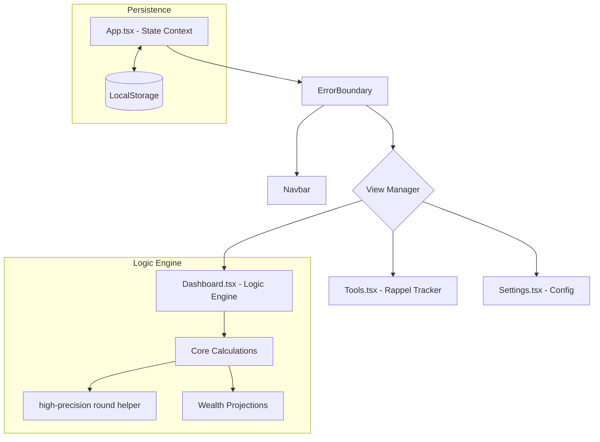

# 💰 eSalaire - Enterprise Financial Planning Suite

**Version:** 1.1.2 (Stable)
**Status:** Production-Ready
**Author:** Mohamed HOUSNI Ph.D.
**License:** Private / Commercial

---

## 1. Executive Overview

**eSalaire** is an industrial-grade, zero-knowledge financial management system designed specifically for the Moroccan socioeconomic landscape. It bridges the gap between simple budget trackers and complex accounting suites by focusing on the "Zero-Trust" mathematical reliability and local-first privacy.

The application implements a unique **30/40/10/10/10 Financial Strategy**, ensuring users maintain a balanced life while building long-term wealth assets and handling local financial nuances like **Source Deductions** and **Retroactive Salary Adjustments (Rappel)**.

### 1.1 Core Value Proposition
- **Privacy Sovereignty:** 100% Local-First. No data ever leaves the device.
- **Context-Aware Logic:** Tailored for Moroccan salary slips (Dahir-compliant deductions).
- **Industrial Stability:** Hardened with React Error Boundaries and high-precision math helpers.

---

## 2. Technical Architecture

### 2.1 Component Hierarchy & Data Flow


### 2.2 Technology Stack
| Layer | Technology | Purpose |
| :--- | :--- | :--- |
| **Foundation** | React 19 + Vite | High-performance PWA core. |
| **Language** | TypeScript | Type-safe financial logic. |
| **Logic** | Custom Math Helpers | IEEE 754 precision correction. |
| **Styling** | Vanilla CSS + Framer Motion | Premium, hardware-accelerated UI. |
| **Visualization** | Recharts | Contextual cashflow and wealth charts. |

---

## 3. Financial Strategy Engine

### 3.1 The 30/40/10/10/10 Rule
The system automatically enforces a balanced budget based on "Spendable Income" (Net Income - Debt):
- **30% Fixed & Housing:** Rent, Traites, Bills.
- **40% Living Essentials:** Groceries, Transport, Health.
- **10% Personal/Wants:** Lifestyle, Hobbies.
- **10% Savings Goals:** Future acquisitions (House, Car, Travel).
- **10% Emergency Fund:** Safety net for medical or car repairs.

### 3.2 High-Precision Calculations
To prevent floating-point drift, all arithmetic is processed via:
```typescript
const round = (num: number) => Math.round((num + Number.EPSILON) * 100) / 100;
```
This ensures that $0.1 + 0.2$ always equals $0.30$, maintaining 100% balance across all category limits.

### 3.3 Dynamic Backpay (Rappel) Tracker
The "Financial Tools" module calculates retroactive arrears based on effective dates and salary differences.
- **Permanent Claiming:** When a permanent salary increase is claimed, the system proportionally updates **all** 5 budget categories to maintain the 30/40/10/10/10 balance in the new income bracket.

---

## 4. User Guide

### 4.1 Getting Started
1. **Onboarding:** Enter your Net Salary (as shown on Virement).
2. **Debt Profile:** Add "Source" deductions (Paie) and "Bank" deductions (Direct Debit).
3. **Liquid Assets:** Enter your current cash on hand to establish your baseline "Net Wealth."

### 4.2 Managing Savings Goals
Create goals with specific targets. Deposits are deducted from your "Liquid Assets" but remain part of your "Net Wealth."
- **Spending from Goals:** Allows you to purchase items using saved funds without impacting your current monthly operational buffer.

### 4.3 Data Management
- **Local Backup:** Export your data as a JSON file via Settings.
- **Reset Month:** Click "Start New Month" to clear spending and credit your salary for the new cycle.

---

## 5. Security & Stability Pass (v1.1.2)

The **v1.1.2 Stability Pass** implemented critical enterprise-grade safeguards:
- **Global Error Boundary:** Prevents "Blank Screen" crashes. If a rendering error occurs, a user-friendly recovery screen allows for a safe reload.
- **Zero-Null Hardening:** Every array operation is guarded with `.filter(Boolean)` and optional chaining to handle malformed legacy data.
- **Division Guarding:** Zero-value budget limits no longer cause crashes in progress bars or charts.

---

## 6. Installation & Deployment

### 6.1 Local Development
```bash
npm install
npm run dev
```

### 6.2 Production Build
```bash
npm run build
```
The resulting `dist` folder is optimized for static hosting and includes a full PWA manifest for mobile installation.

---

## 7. Visionary Roadmap (Future Features)

To maintain its position as a leading financial suite, the following features are planned for future releases:

### 7.1 Intelligence & Automation
- **AI-Powered Cash Flow Forecasting:** Predictive analytics to warn about potential month-end deficits.
- **Smart Anomaly Detection:** Real-time alerts for unusual spending patterns or subscription price hikes.
- **Natural Language Queries:** "Search" your finances with questions like *"How much did I spend on cafes last Ramadan?"*

### 7.2 Moroccan Financial Ecosystem
- **Open Banking Integration:** Secure, read-only connections to major Moroccan banks (CIH, BMCE, Attijariwafa) using tokenized APIs.
- **Digital Dirham Integration:** Early support for Bank Al-Maghrib's upcoming CBDC.
- **Zakat & Sadaqa Calculator:** Native tools to calculate Zakat Al-Maal based on lunar years and current gold prices.

### 7.3 Advanced Management
- **Multi-Currency Support:** Track assets in MAD, EUR, or USD for expats and remote workers.
- **Debt Avalanche/Snowball Simulators:** Interactive modeling to find the fastest path to being debt-free.
- **Subscription 'Silent Spending' Tracker:** Automated identification of recurring monthly commitments.

---

**© 2026 Mohamed HOUSNI Ph.D. All Rights Reserved.**